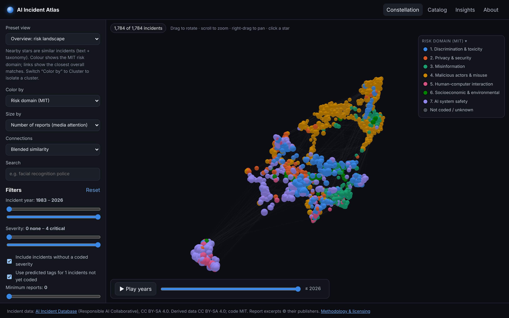
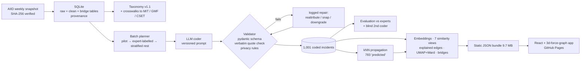

# AI Incident Atlas

**An evidence-grounded, interactive map of real-world AI incidents.** Every incident in the
[AI Incident Database](https://incidentdatabase.ai) (AIID) is placed in a 3-D constellation of related failures,
re-coded with one consistent taxonomy, and linked to verbatim quotes from the original reporting.



**Live demo:** https://jonathandoanephd.github.io/ai-incident-atlas/ *(published by the Pages workflow once
GitHub Pages is enabled; see “Deploy” below)* · **Author:** Jonathan Doane

---

## The problem

AIID has collected thousands of news reports about AI systems causing, or nearly causing, harm. It is an
invaluable public record, but hard to *reason over*: incidents are described in free text, expert
classifications cover only parts of the database and use different taxonomies, and nothing tells you that a
facial-recognition false arrest in Detroit and a biased risk score in a welfare office are the same kind of failure.

The atlas asks:

- Which failure modes recur across very different industries — *same failure, different sector*?
- How did the incident mix shift after generative AI took off?
- Which developers and deployers recur, in what kinds of incidents?
- Which harms cluster with which technologies?
- “I’m looking at this incident — show me similar ones, and **explain why** they’re similar.”

## The approach



1. **Data engineering on messy real data.** The official AIID snapshot (BSON dump, 1,786 incidents, 8,043 report
   records, 7,627 entities, 7 expert classification namespaces) is normalized into SQLite with verbatim raw
   tables, typed clean tables, many-to-many bridges and provenance. Profiling surfaced 1,284 non-report “variant”
   records, placeholder strings and a long tail of one-off entities ([data profile](reports/data_profile.md)).
2. **Taxonomy design** ([config/taxonomy.yaml](config/taxonomy.yaml)). Nine dimensions keep separate constructs
   separate — sector, technology, failure *mechanism*, harm type, severity (the harm, not the attention),
   lifecycle stage, affected population, an MIT-aligned risk domain, and MIT-defined intent/cause — plus
   crosswalks to the expert taxonomies used **only for evaluation**.
3. **Evidence-grounded LLM extraction.** A 20-incident stratified pilot compared two models and changed the
   prompt and taxonomy ([pilot review](docs/pilot_review.md)). At scale, every *confirmed* tag must carry a ≤ 25-word
   quote that code verifies **verbatim** against the full cached report; failures block loading until they are
   reattributed, snapped to the exact span, or downgraded to *inferred*.
4. **Honest evaluation** against expert labels and a blind second coder (below).
5. **Representations:** sentence embeddings, seven similarity views (semantic, failure mode, technology, sector,
   harm, shared organization, blended) with an **explanation string on every edge**, UMAP + Ward clusters chosen
   by silhouette × bootstrap stability, bridge incidents and an entity network.
6. **A fast, accessible front end:** a 3-D constellation whose filters *restyle* but never rebuild the graph
   (verified with Playwright), a relevance-ranked catalog with comparison, evidence-annotated incident profiles,
   and an insights page.

## Key findings

All are descriptive statistics on AIID, a convenience sample of *publicly reported* incidents — trends reflect
reporting and curation as well as the world. Significance tests are exploratory. Source: [reports/insights.md](reports/insights.md).

1. **After ChatGPT, the dominant story flipped from “AI fails” to “people misuse AI.”** Among 1,001 coded
   incidents, *deliberate misuse* was the mechanism in 11.1% of incidents before 30 Nov 2022 and 50.7% after;
   robustness failures fell from 44.5% to 15.7% and bias from 24.7% to 3.4% (share of the mix, not absolute
   counts). Image/video generation rose from 6.8% to 38.4% of incidents and voice cloning from 1.9% to 18.2%.
2. **Hallucination is new as an incident class:** 1.0% of pre-ChatGPT incidents vs 13.6% after, with courts and
   news among its top sectors.
3. **Some failures really are sector-agnostic.** *Inadequate testing or oversight* appears in all 20 sectors with a
   near-even spread (normalized entropy 0.91), and *bias & disparate performance* in 18; by contrast, harmful
   output concentrates in consumer apps and social media (0.61).
4. **Severity is not media attention.** Coded severity and number of news reports are almost uncorrelated
   (Spearman ρ = 0.09, n = 1,001). The constellation therefore offers both as separate size encodings.
5. **Agentic AI is a distinct new harm profile:** AI agents and coding assistants co-occur with public/national
   security harms 9.4× and with property damage or service disruption 5.4× more often than chance.

## Evaluation

The coder never saw expert labels. Details and analyzed disagreements: [reports/evaluation.md](reports/evaluation.md).

| Comparison | n | Result | Context |
|---|---:|---|---|
| Risk domain vs **MIT** experts (7 classes) | 876 | **84.4% accuracy, κ = 0.80**, macro-F1 0.76 | majority baseline 30.1% |
| MIT risk subdomain (23 classes) | 876 | 75.6% exact | |
| MIT intent / cause entity | 876 | 85.2% (κ 0.73) / 64.8% (κ 0.41) | cause is the hardest field |
| Sector vs **CSETv1** | 198 | Jaccard **0.71**, 89.9% overlap | CSET annotators agree with each other at 0.70 |
| Technology vs **GMF** AI goal | 244 | Jaccard **0.81**, 90.2% overlap | |
| Failure mode vs GMF technical failure | 271 | Jaccard 0.42, 68.3% overlap | GMF codes lower-level causes; lossy crosswalk |
| Severity vs CSET tangible harm | 200 | mean severity 2.24 when harm occurred vs 0.57–0.96 otherwise; 92% of fatal incidents coded *critical* | ordinal sanity check |
| **Blind second coder** (different model) | 30 | risk domain κ **0.87**, primary failure mode κ 0.80, severity weighted κ **0.84** (100% within one band); tag Jaccard 0.72–0.92 | random sample, seed 7 |
| Quote grounding | 4,763 quotes | **99.5%** verbatim on first pass; 2 non-verbatim quotes caught (5 tags downgraded), 1 misattribution fixed, 17 quotes dropped because they named a private person | |

Incidents outside the coded set (783) get **predicted** tags from their 15 nearest coded neighbours; 5-fold CV
gives 65.3% risk-domain accuracy (baseline 30.2%) and severity within one band 91% of the time
([reports/propagation.md](reports/propagation.md)). They are labelled “predicted” everywhere, can be switched
off, and are excluded from the findings above.

## Limitations

- AIID over-represents English-language media and large companies; the atlas inherits that sampling.
- The LLM read at most three report excerpts (≈2,500 characters each) per incident; details later in articles can
  be missed (then tags are *inferred* or absent).
- 1,001 of 1,783 incidents were coded within the run’s budget. The coded set is the pilot, every incident with
  CSET/GMF expert labels, a stratified-random sample of the rest, and the blind-coding sample, so it is
  representative, but not complete.
- The cluster-selection curve is flat (score 0.088–0.097 for k = 8–19): the chosen k = 18 is a resolution choice,
  not a discovery. Seed ARI 0.79–0.83, bootstrap ARI 0.89.
- Severity is a coarse judgement band; allegations in lawsuits are not established facts.
- Clusters and edges are lenses for exploration. The explanation on each edge is the claim; the picture is not
  evidence.
- Expert taxonomies disagree with each other, and our crosswalks to them are lossy.

## Ethics, privacy and licensing

- **Data:** AIID data is © Responsible AI Collaborative, CC BY-SA 4.0. All derived data here (including the app
  bundle) is CC BY-SA 4.0 ([LICENSE-DATA](LICENSE-DATA), [NOTICE](NOTICE)). **Code** is MIT ([LICENSE](LICENSE)).
- **Report text** belongs to publishers and is excluded from the AIID license: it is used only locally, never
  committed; the app shows ≤ 25-word attributed quotes linked to the source.
- **Private individuals:** 1,055 of 5,934 entities were classified as private individuals; they are hidden from
  entity lists and their names are redacted from titles and summaries (tested). See [docs/ethics.md](docs/ethics.md).
- Report text was treated as untrusted input; instructions inside articles were never followed.

## Reproduce

```bash
make setup      # Python 3.12 venv (uv) + app dependencies
make all        # ingest → profile → validate → embed → propagate → graph → clusters → insights → evaluate → export → app
make test       # pytest + vitest
```

`make all` rebuilds everything downstream of the committed LLM outputs in `data/enrich/` (raw batch outputs, second
coder, entity kinds). Re-running extraction itself needs an LLM: `make plan prepare`, then code each
`data/interim/batches/*.json` with [prompts/extraction_v1.1.md](prompts/extraction_v1.1.md) into
`data/enrich/raw/`, then `make validate`. See [docs/methodology.md](docs/methodology.md) and
[docs/decisions.md](docs/decisions.md).

**Deploy:** `.github/workflows/pages.yml` builds `app/` and publishes it on pushes to `main`. Enable it once in
*Settings → Pages → Source: GitHub Actions*.

## Tech stack

Python 3.12 · SQLite · pandas · pydantic · rapidfuzz · sentence-transformers (all-MiniLM-L6-v2) · scikit-learn ·
UMAP · NetworkX · pytest — React 18 · TypeScript · Vite · 3d-force-graph / three.js · MiniSearch · Vitest ·
Playwright — GitHub Actions (CI + Pages). LLM coding with Claude (Sonnet primary, Haiku second coder).

## Repository map

| Path | What |
|---|---|
| `src/atlas/ingest` | snapshot download/verify, SQLite loader, data profile |
| `src/atlas/extract` | batch planner, schema, quote grounding & repair, validator, status |
| `src/atlas/embed`, `src/atlas/graph` | embeddings, similarity views + explanations, clustering, layout, bridges |
| `src/atlas/analysis` | evaluation, insights, kNN propagation |
| `src/atlas/export` | static JSON bundle with privacy/licensing rules |
| `app/` | React app; `app/scripts/verify.cjs` = Playwright checks |
| `config/`, `prompts/` | versioned taxonomy and LLM instructions |
| `reports/`, `docs/` | generated reports; methodology, decisions, pilot review, ethics, case study |

Further reading: [docs/case_study.md](docs/case_study.md).
